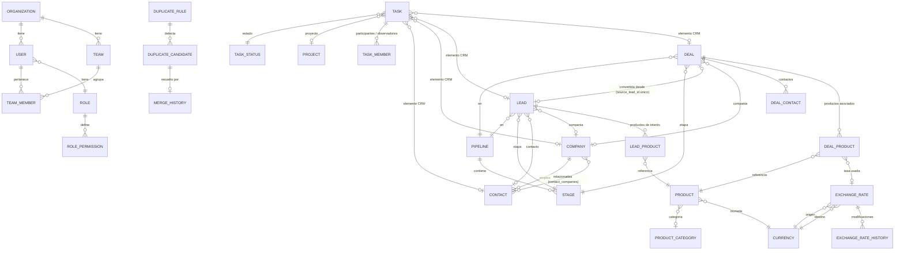

# 02 — Modelo de datos

> Estado: **propuesta**. PostgreSQL 16 vía Prisma. Nombres de tabla en `snake_case`.

## 1. Convenciones comunes

Toda tabla de negocio lleva:

| Columna                          | Uso                                                                    |
| -------------------------------- | ---------------------------------------------------------------------- |
| `id` `uuid`                      | Clave primaria (UUID v7: ordenable por tiempo)                         |
| `organization_id` `uuid`         | Organización dueña; primera columna de todos los índices; RLS [D-02]   |
| `created_at`, `updated_at`       | `timestamptz`                                                          |
| `created_by_id`, `updated_by_id` | Usuario que creó / modificó                                            |
| `deleted_at`, `deleted_by_id`    | Eliminación lógica (papelera). `NULL` = vivo                           |
| `version` `int`                  | Control de concurrencia optimista                                      |
| `custom_fields` `jsonb`          | Valores de campos personalizados (en entidades que los admiten), índice GIN |

- **Dinero:** importes `numeric(20,4)`, tasas `numeric(20,10)`, cantidades `numeric(18,4)`.
  Nunca `float`. Moneda siempre como código ISO `char(3)` junto al importe.
- **Fechas:** `timestamptz`; fechas sin hora (`date`) para vigencia de tipos de cambio, inicio y
  vencimiento de proyectos. Zona horaria de la organización (por defecto `America/Lima`).
- **Unicidad con papelera:** las restricciones únicas son índices parciales
  `WHERE deleted_at IS NULL`, para que un registro eliminado no bloquee uno nuevo — y al
  restaurar se detecta el conflicto (ver papelera en [04](04-reglas-negocio.md)).
- **Borrado físico:** solo desde la papelera, con permiso y confirmación. Las FK hacia registros
  comerciales usan `ON DELETE RESTRICT`; la eliminación definitiva comprueba dependencias antes.

## 2. Diagrama entidad-relación (núcleo comercial)

## 3. Entidades

### 3.1 Organización, usuarios y permisos

| Tabla                    | Campos principales                                                                                                  | Notas |
| ------------------------ | ------------------------------------------------------------------------------------------------------------------- | ----- |
| `organizations`          | nombre, razón social, RUC, zona horaria, idioma, logo, `base_currency_code`                                         | [D-02] |
| `organization_settings`  | `key`, `value jsonb` (retención de papelera, regla de selección de tasas, redondeo, formato de fecha, límites)     | Un registro por clave |
| `users`                  | correo (`citext`, único), nombre, `password_hash`, `role_id`, activo, último acceso, intentos fallidos, bloqueado hasta | Desactivar ≠ borrar |
| `sessions`               | `user_id`, hash del token, expira, IP, user-agent, revocada                                                        | |
| `password_reset_tokens`  | `user_id`, hash del token, expira, usado                                                                           | Un solo uso |
| `teams`                  | nombre, descripción, `supervisor_id`, activo                                                                        | |
| `team_members`           | `team_id`, `user_id`                                                                                                | Un usuario puede estar en varios equipos |
| `roles`                  | nombre, descripción, `is_system` (Administrador, Supervisor, Comercial no se borran)                               | |
| `role_permissions`       | `role_id`, `module`, `action`, `scope` (`NONE`/`OWN`/`TEAM`/`ALL`)                                                  | Acciones: ver, crear, editar, eliminar, importar, exportar, restaurar, eliminar_definitivo, fusionar, editar_tasas, administrar |

### 3.2 Configuración

| Tabla                        | Campos principales                                                                                       |
| ---------------------------- | -------------------------------------------------------------------------------------------------------- |
| `pipelines`                  | `entity_type` (`LEAD`/`DEAL`), nombre, orden, por defecto, activo                                         |
| `stages`                     | `pipeline_id`, nombre, orden, color, `kind` (`OPEN`/`WON`/`LOST`/`CONVERTED`), probabilidad por defecto, activo |
| `priorities`                 | nombre, color, ícono, `rank`, por defecto, activo — semilla: Urgente (rojo), Alta (naranja), Media (amarillo), Baja (verde) |
| `lead_sources`               | nombre, activo (Web, Referido, Evento, Llamada, Redes sociales, Otro)                                     |
| `loss_reasons`               | `entity_type`, nombre, activo [D-17]                                                                     |
| `document_types`             | código, nombre, patrón de validación (DNI 8 dígitos, RUC 11, CE, Pasaporte)                               |
| `economic_sectors`           | nombre, activo                                                                                           |
| `product_categories`         | nombre, `parent_id`, activo                                                                              |
| `task_statuses`              | nombre, color, orden, `category` (`OPEN`/`IN_PROGRESS`/`REVIEW`/`DONE`/`CANCELED`), activo                 |
| `custom_field_definitions`   | `entity_type`, `key`, etiqueta, tipo (texto, texto largo, número, moneda, fecha, sí/no, lista, lista múltiple, usuario, URL, correo, teléfono), opciones, obligatorio, sección, orden, activo [D-12] |
| `sequences`                  | `entity_type`, prefijo, `next_value` — códigos `PRO-000001`, `NEG-…`, `TAR-…`, `PRY-…`, `CON-…`, `CIA-…` [D-11] |
| `saved_views`                | `user_id` (o compartida), `entity_type`, nombre, columnas, orden, filtros, modo (lista/kanban)           |

Un elemento de configuración **en uso no se borra**: se desactiva. Así los registros históricos
conservan su etapa, prioridad o estado aunque ya no se ofrezca para registros nuevos.

### 3.3 Contactos y compañías

| Tabla               | Campos principales |
| ------------------- | ------------------ |
| `companies`         | código, razón social, nombre comercial, `tax_id` (RUC u otro), `tax_id_type`, `sector_id`, dirección, ciudad, país (ISO 3166), correo, teléfono, sitio web, `owner_id` (responsable comercial), observaciones, campos personalizados |
| `contacts`          | código, nombres, apellidos, `document_type_id`, número de documento, teléfono, correo, cargo, `company_id` (principal), `owner_id`, observaciones, campos personalizados |
| `contact_companies` | `contact_id`, `company_id`, cargo en esa compañía — "compañías relacionadas" además de la principal |

Columnas normalizadas para búsqueda y duplicados, generadas (`GENERATED ALWAYS AS … STORED`):
`email_norm` (minúsculas, sin espacios), `phone_norm` (solo dígitos, con prefijo país),
`name_norm` (sin tildes, minúsculas, espacios simples). Índices `pg_trgm` sobre nombres.

### 3.4 Productos

| Tabla      | Campos principales |
| ---------- | ------------------ |
| `products` | código SKU (único vivo), nombre, descripción, `category_id`, precio `numeric(20,4)`, `currency_code`, descuento máximo permitido (%), activo, campos personalizados |

### 3.5 Prospectos

| Tabla           | Campos principales |
| --------------- | ------------------ |
| `leads`         | código, título, `contact_id`, `company_id`, teléfono, correo (pueden diferir del contacto o existir sin él), `source_id`, `pipeline_id`, `stage_id`, `stage_position` (orden en columna Kanban), `owner_id`, `priority_id`, `currency_code`, valor estimado, observaciones, `loss_reason_id`, `loss_note`, `converted_at`, `converted_deal_id`, `stage_changed_at`, campos personalizados |
| `lead_products` | `lead_id`, `product_id`, posición, **copia**: SKU, descripción comercial, cantidad, precio unitario, `currency_code` original, descuento, y, si la moneda difiere de la del prospecto: `exchange_rate`, `exchange_rate_date`, `exchange_rate_id`, importe convertido, importe final |

No existe el campo "fecha de próxima actividad": la próxima actividad se obtiene de la tarea
abierta más próxima relacionada con el prospecto.

### 3.6 Negociaciones

| Tabla           | Campos principales |
| --------------- | ------------------ |
| `deals`         | código, título, `source_lead_id` (**único**, nulo si no viene de un prospecto), `company_id`, `pipeline_id`, `stage_id`, `stage_position`, `owner_id`, `priority_id`, `currency_code`, valor estimado, **subtotal, descuento, total** (calculados y guardados), valor final, probabilidad (%), fecha estimada de cierre, `status` (`OPEN`/`WON`/`LOST`), `closed_at`, `loss_reason_id`, `loss_note`, campos personalizados |
| `deal_contacts` | `deal_id`, `contact_id`, principal (sí/no), rol en la negociación |
| `deal_products` | igual que `lead_products` + `source_lead_product_id` (trazabilidad de la conversión) + `line_subtotal`, `line_discount`, `line_total` en moneda de la negociación |

### 3.7 Monedas y tipos de cambio

| Tabla                     | Campos principales |
| ------------------------- | ------------------ |
| `currencies`              | `code` ISO 4217 (único por organización), nombre, símbolo, decimales (0–4), posición del símbolo, separadores, principal (índice único parcial: una sola), activo. Semilla: PEN (principal), USD |
| `exchange_rates`          | fecha de vigencia (`date`), moneda origen, moneda destino, tasa `numeric(20,10)` (`CHECK > 0`), `status` (`ACTIVE`/`INACTIVE`), fuente (manual / importación), creado y modificado por/en. Índice único parcial `(organization_id, date, from, to) WHERE status='ACTIVE' AND deleted_at IS NULL` |
| `exchange_rate_history`   | `exchange_rate_id`, tasa anterior, tasa nueva, estado anterior/nuevo, motivo, usuario, fecha |
| `exchange_rate_overrides` | tasa elegida manualmente por un usuario autorizado cuando no había tasa válida: importe, tasa, motivo, usuario, fecha, a qué línea/reporte se aplicó [D-05] |

### 3.8 Tareas y proyectos

| Tabla          | Campos principales |
| -------------- | ------------------ |
| `projects`     | código, nombre, descripción, `owner_id`, estado (`PLANNED`/`ACTIVE`/`ON_HOLD`/`CLOSED`), fecha inicio, fecha fin (`CHECK fin >= inicio`) |
| `tasks`        | código, título, descripción, `responsible_id`, fecha inicio, vencimiento, `priority_id`, `status_id`, `status_position` (Kanban), `project_id`, `completed_at`, y elemento CRM: `contact_id`, `company_id`, `lead_id`, `deal_id` con `CHECK (num_nonnulls(contact_id, company_id, lead_id, deal_id) <= 1)` |
| `task_members` | `task_id`, `user_id`, `role` (`PARTICIPANT`/`OBSERVER`), único por (tarea, usuario) |

Se usan FK explícitas (no una relación polimórfica `entity_type + entity_id`) para que la base de
datos garantice la integridad referencial.

### 3.9 Colaboración e historial

| Tabla            | Campos principales |
| ---------------- | ------------------ |
| `comments`       | cuerpo (texto plano / markdown limitado, sin HTML), autor, menciones, FK a una de: `lead_id`, `deal_id`, `contact_id`, `company_id`, `task_id` (`CHECK num_nonnulls(...) = 1`), editado en |
| `activities`     | registro manual de interacciones: tipo (llamada, reunión, correo, nota), fecha, resultado, autor, FK al elemento CRM como en `comments` [D-23] |
| `record_history` | `entity_type`, `entity_id`, acción (`CREATE`, `UPDATE`, `STAGE_CHANGE`, `DELETE`, `RESTORE`, `MERGE`, `CONVERT`, `IMPORT`), `changes jsonb` (campo → antes/después), usuario, fecha, `correlation_id` | 
| `audit_log`      | evento de seguridad o sensible (login, fallo de login, cambio de permisos, exportación, eliminación definitiva, fusión, restauración, modificación de tasa), usuario, IP, detalle `jsonb`, fecha |
| `notifications`  | `user_id`, tipo, título, enlace, entidad, leída en, creada en |

`record_history` y `audit_log` son **solo inserción** (el rol de la app no tiene `UPDATE` ni
`DELETE` sobre ellas) y sobreviven a la eliminación definitiva del registro.

### 3.10 Duplicados

| Tabla                 | Campos principales |
| --------------------- | ------------------ |
| `duplicate_rules`     | `entity_type`, nombre, activo, `conditions jsonb` = lista de `{campo, es_personalizado, modo: EXACT / NORMALIZED / FUZZY, umbral}` combinadas con Y, bloquear o avisar al guardar |
| `duplicate_candidates`| `rule_id`, `entity_type`, `record_a_id`, `record_b_id` (par ordenado, único), puntaje, campos coincidentes, `status` (`OPEN`/`KEPT_BOTH`/`REVIEWED`/`MERGED`), revisado por/en, origen (manual, guardado, importación) |
| `merge_history`       | `entity_type`, `survivor_id`, `merged_id`, elección por campo (`jsonb`), relaciones movidas (`jsonb`: tabla, ids), **instantánea completa** del registro absorbido, usuario, fecha |

### 3.11 Papelera

| Tabla          | Campos principales |
| -------------- | ------------------ |
| `trash_entries`| `entity_type`, `entity_id`, nombre visible, código, eliminado por/en, `status` (`IN_TRASH`/`RESTORED`/`PURGED`), relaciones relevantes (`jsonb`: p. ej. compañía, contactos, negociaciones dependientes), `purge_after` (según retención), `cascade_group_id` (registros eliminados juntos) |

El registro sigue en su tabla con `deleted_at`; `trash_entries` es el índice transversal de la
papelera (buscar, filtrar por módulo, restaurar, purgar) sin duplicar los datos.

### 3.12 Importación y exportación

| Tabla         | Campos principales |
| ------------- | ------------------ |
| `import_jobs` | `entity_type`, archivo, formato, mapeo de columnas, modo de duplicados (`SKIP`/`UPDATE`/`CREATE`), clave de correspondencia, estado, totales (válidos, inválidos, creados, actualizados, omitidos), reporte de errores, usuario |
| `export_jobs` | `entity_type`, filtros, columnas, formato, estado, archivo, filas, usuario, expira en |

## 4. Índices principales

- Todas las listas: `(organization_id, deleted_at, <orden por defecto>)`.
- Kanban: `(organization_id, pipeline_id, stage_id, stage_position) WHERE deleted_at IS NULL`.
- Responsable y fechas: `(organization_id, owner_id)`, `(organization_id, created_at)`,
  tareas `(organization_id, responsible_id, due_at) WHERE completed_at IS NULL`.
- Búsqueda global: `pg_trgm` GIN sobre nombres, códigos, correos y teléfonos normalizados.
- Campos personalizados: GIN sobre `custom_fields`.
- Tipos de cambio: `(organization_id, from_currency, to_currency, date DESC) WHERE status='ACTIVE'`.

## 5. Lo que no existe en el modelo

No hay entidades de automatizaciones, reglas comerciales automáticas, disparadores, flujos de
trabajo, WhatsApp, SUNAT ni facturación.
